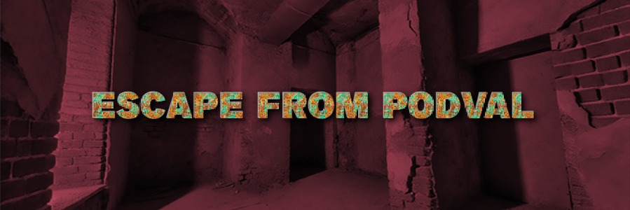
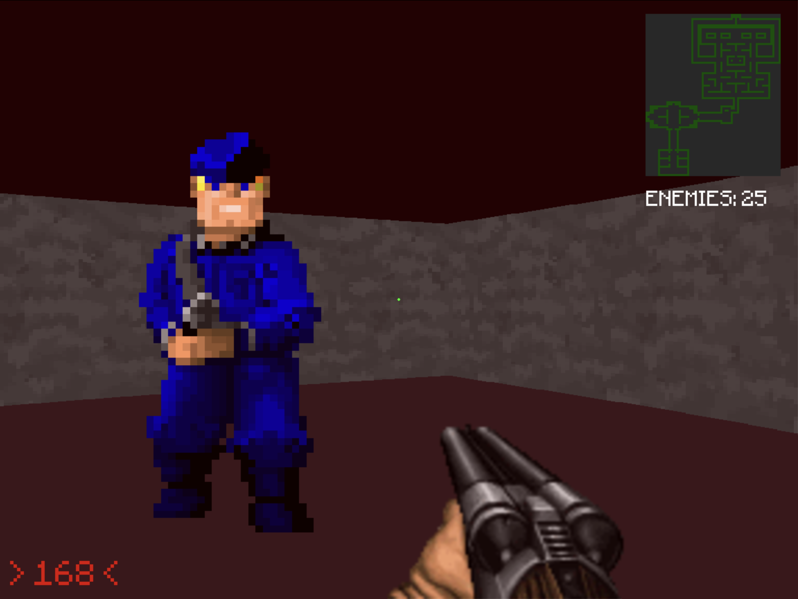
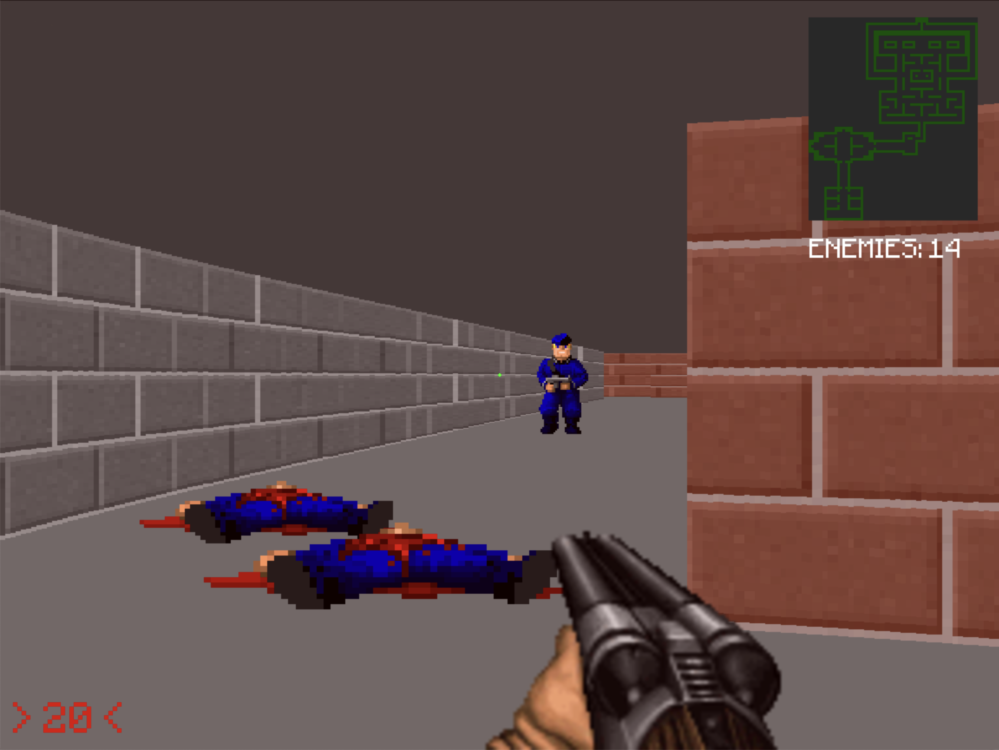

# **Escape From Podval 2: The Videogame**

**Разработчик:** Malakhov Alexey Vitalevich  
**Издатель:** Malakhov Alexey Vitalevich  
**Дата выхода:** 29 октября 2026



---

## Описание

> Подвал вернулся. И стал быстрее.

"Escape From Podval 2" — долгожданное продолжение культового шутера от первого лица. Те же тесные и темные лабиринты заброшенного подземелья, тот же скрежет металла и пугающий шепот из глубины — но теперь игра переписана на **Rust**, а кадровая частота больше ничем не ограничена.

Разработчики бережно перенесли каждый пиксель и каждую механику первой части: проверено автотестом, что сиквел совпадает с оригиналом кадр в кадр. Вас по-прежнему ждет более **5 минут** игрового процесса — но теперь на **сотнях FPS**.

---

## Что нового во второй части

- ⚡ **Неограниченный FPS** — вместо скромных 60 кадров игра рисует столько, сколько выдержит ваш компьютер.
- 🦀 **Движок на Rust** — никаких интерпретаторов: один бинарник, мгновенный запуск.
- 🎯 **Плавность** — движение игрока и врагов сглажено между игровыми тиками, мышь отзывается в каждом кадре.
- ⌨️ **WASD на любой раскладке** — бежать из подвала можно даже на русской.

## Что осталось от первой части

- 🔦 **Тесные коридоры подвала** — исследуйте запутанные коридоры и скрытые комнаты, каждый шаг может стать последним.
- 💥 **Брутальные перестрелки** — почувствуйте отдачу оружия и ощутите адреналин, когда каждый патрон на счету.
- 🎶 **Оригинальный саундтрек** — музыка от известного композитора enggineer_sound.

---

## Требования системы

### Минимальные:
- **ОС:** Windows 10 (64-bit) / Linux
- **Процессор:** Intel Core i5-6400 / AMD Ryzen 3 1200
- **Оперативная память:** 8 GB RAM
- **Видеокарта:** NVIDIA GeForce GTX 970 / AMD Radeon RX 570
- **Rust:** stable
- **Место на диске:** 80 MB

### Рекомендуемые:
- **ОС:** Windows 11 (64-bit) / Linux
- **Процессор:** Intel Core i7-9700 / AMD Ryzen 5 3600
- **Оперативная память:** 16 GB RAM
- **Видеокарта:** NVIDIA GeForce RTX 2070 / AMD Radeon RX 6700 XT
- **Rust:** stable
- **Место на диске:** 80 MB

---

## Скриншоты




---

## Отзывы игроков

> **"Игра потрясающая! Великолепная графика и увлекательный геймплей!"**  
> — _СашаТрубачев2005_

> **"Динамика боя просто шикарная, а атмосфера подвала захватывает с первых минут."**  
> — _PlayGeim_

> **"Те же 5 минут подвала, но теперь в 700 FPS. Сиквел года."**  
> — _ПодвальныйОбозреватель_

---
## Купить игру

- **Цена:** 0 ₽
- **Купить сейчас:** `git clone https://github.com/alexzomai/escape-from-podval-2.git`

---

## Скачать

Готовые сборки — на странице [релизов](https://github.com/alexzomai/escape-from-podval-2/releases/latest):
`EscapeFromPodval2.exe` для Windows и `EscapeFromPodval2.sh` для Linux. Это один файл, ничего ставить не нужно.

## Сборка и запуск

Нужны Rust (stable) и библиотеки SDL2 и SDL2_ttf, на Linux ещё ALSA:

- Arch: `pacman -S sdl2-compat sdl2_ttf alsa-lib`
- Debian/Ubuntu: `apt install libsdl2-dev libsdl2-ttf-dev libasound2-dev`

```sh
cargo run --release
```

Ассеты вшиты в бинарник, так что игра — один файл.

Управление прежнее: WASD — ходьба, мышь — поворот, ЛКМ — выстрел, Esc — выход.

`cargo run --release -- --bench 5` пять секунд гоняет игру без меню и звука и печатает средний FPS.

Релизы собирает `.github/workflows/release.yml` при пуше тега `v*`: SDL2 и SDL2_ttf
линкуются статически (на Linux — из `scripts/build-sdl-static.sh`, на Windows — из vcpkg),
а `scripts/make-sh.sh` упаковывает Linux-бинарник в самораспаковывающийся `.sh`.

## Как устроен порт

Код повторяет модули первой части ([escape-from-podval](https://github.com/alexzomai/escape-from-podval)): `settings`, `map` (`mapdata.py`), `player`, `raycast`
(`ray_casting.py`), `sprites`, `game` (`interactions.py` и цикл из `main.py`), `render`.
Картинка рисуется программно в буфер с той же арифметикой, что у pygame
(масштабирование `transform.scale`, смешивание альфы, округление координат `Rect`),
текст рендерится через SDL_ttf — ту же библиотеку, что под `pygame.font`.

Вся механика оригинала посчитана в кадрах при 60 FPS: скорость 6 px за кадр,
анимации, урон 0.1 за кадр. Поэтому логика работает фиксированным шагом 60 Гц,
а отрисовка не ограничена: позиции игрока и врагов интерполируются между шагами,
поворот мышью применяется сразу в каждом кадре.

## Тесты

```sh
cargo test
```

`tests/parity.rs` сверяет порт с оригиналом. Эталон в `tests/data/parity` снят
скриптом `tests/reference/harness.py`: он запускает Python-версию с ботом,
который 7200 кадров ходит по карте, стреляет и получает урон. Тест подаёт тот же
ввод в Rust-версию и проверяет, что состояние игры совпадает побитно, а каждый
кадр — попиксельно (CRC32 экрана), плюс экраны меню, победы и поражения.
